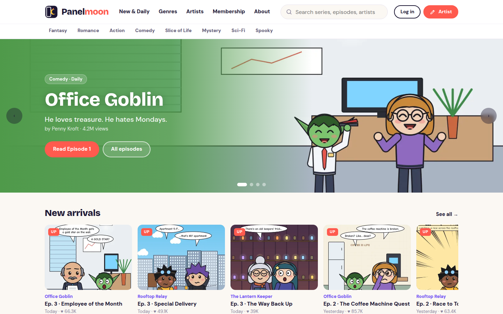
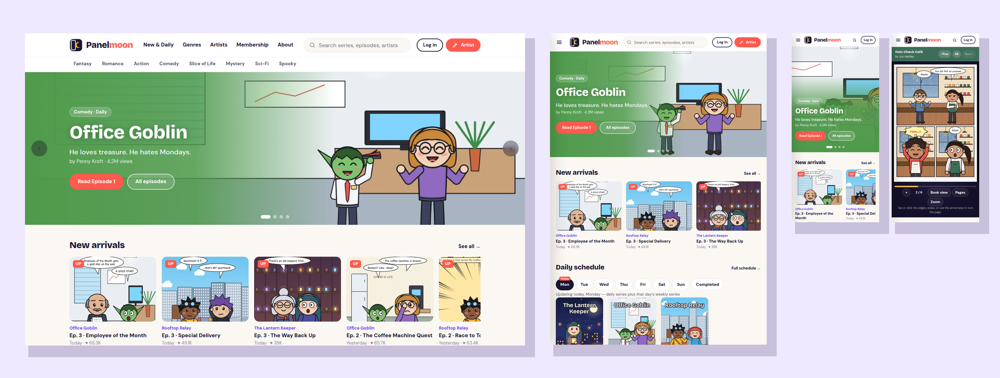

# Panelmoon — SkyNet Web Comic Template

A responsive web comic (webtoon-style) website template for **ASP.NET Core (.NET 10)**, built on the **SkyNet Framework**.
Free and open source. **100% AI-driven coding — built by Claude.**

[](https://dotnet.microsoft.com/)
[](https://www.nuget.org/packages/TheSkyLite.SkyNet)
[](LICENSE)
[](#100-ai-driven-coding)

**Live demo:** https://www.theskylite.com/WebComic



> **Fictional platform.** Panelmoon and every series, character, artist, comment and number on it are invented for demonstration. Sign-in, likes, comments, memberships and publishing are demos — nothing is stored, uploaded or charged.

---

## Features

- **12 pages:** Home, New & Daily, Genres, Artists, Series, Episode, Search, Membership, Member Login, Artist Login, Artist Studio, About
- **Responsive:** desktop, tablet and phone layouts
  - Desktop: top menu, genre bar, live search suggestions
  - Tablet: compact header with a slide-in menu
  - Phone: slide-in menu, search toggle, swipe-friendly reader
- **Page-flipping reader:** every episode opens like a book
  - Desktop: two-page spreads with a 3D page turn
  - Tablet: spreads in landscape, single pages in portrait
  - Phone: single pages, swipe to turn
  - Arrow keys, tap or click zones, page counter, progress bar, page strip, zoom and full screen
  - An end-of-episode card with the next episode, or "The End" for completed series
- **Series:** daily or weekly schedules, episodes #1, #2, #3…, "UP" badges for new episodes, ongoing or completed status, subscribe button and episode list (newest or first)
- **Like, dislike and comments** on every episode, worked out on the server; members can post comments (validated on the server)
- **Browse:** New & Daily with a Mon–Sun schedule, Genres with schedule, status and sort filters, Artists with profiles and follow buttons, and full search across series, episodes and artists
- **Member login and Artist login:** any email and password signs in for the demo; the name shows in the header on every page
- **Artist Studio:** a demo publishing tool
  - Pick a series (or start a new one), episode number, title and release time
  - Drag and drop page images from your computer, then drag the thumbnails to change the reading order (arrow buttons on touch screens)
  - Preview the episode in the page-flipping reader
  - Publish: the server checks every field and the page list — the images never leave your browser
- **Membership:** Free, Plus and Creator plans, a comparison table and a sign-up form validated on the server
- **Painted artwork:** 8 original series, 24 episodes and 144 comic pages, plus covers, banners and artist portraits — 192 WebP images painted in code by Claude; no stock art
- **No front-end build:** plain HTML, CSS and vanilla JavaScript; no npm, no bundler, no SPA framework



---

## Getting started

**Requirements:** .NET 10 SDK and Visual Studio (or any editor with the `dotnet` CLI).

```bash
git clone https://github.com/hkim6000/SkyNet-WebComicWebsite-Asp.net.Core-Full-Source.git
cd SkyNet-WebComicWebsite-Asp.net.Core-Full-Source
dotnet run
```

Or open `WebComic.csproj` in Visual Studio and press **F5**.
The SkyNet package (`TheSkyLite.SkyNet`) restores automatically from NuGet.
The app opens on **Home** — the startup page set in `appConfig/application.cfg`.

**Demo sign-in:** any email and any password, on both **Member login** and **Artist login**.

---

## Project structure

```
WebComic/
├── appConfig/application.cfg      app settings and folder names (startup page = Home)
├── codes/                         page classes (C#)
│   ├── Models/WebComicModel.cs    data DTOs
│   ├── Home.cs  Series.cs  Episode.cs  Studio.cs  ...
├── htmls/                         page markup
├── scripts/                       page JavaScript
├── styles/                        page CSS
├── data/site.json                 genres, artists, series, episodes, comments, plans
├── images/
│   ├── pages/{series}/{episode}/  comic pages (WebP)
│   ├── thumbs/{series}/           episode thumbnails
│   ├── covers/  banners/          series art
│   ├── artists/                   artist portraits
│   └── logo.svg
├── Properties/launchSettings.json   hot reload off
└── Program.cs
```

### One page = four files, one name

| File | Holds |
|---|---|
| `codes/Episode.cs` | the page class (`: WebPage`) and its server methods |
| `htmls/Episode.html` | markup with `{plhd_*}` placeholders |
| `scripts/Episode.js` | one IIFE namespace, `EpisodeJs` |
| `styles/Episode.css` | styles, every class prefixed (`ep-`) |

Each page is self-contained: its own CSS prefix, its own script and its own C# methods.

---

## SkyNet in action

The browser calls a C# method; the method returns an `ApiResponse`; only those parts of the page change.
One request can return one or more instructions, applied at the same time.

```js
// scripts/Episode.js
$ApiRequest('Episode/React', JSON.stringify([
    { key: 's', vlu: 'lantern-keeper' },
    { key: 'e', vlu: '1' },
    { key: 'vote', vlu: 'like' },
    { key: 'prev', vlu: '' }
]));
```

```csharp
// codes/Episode.cs
public async Task<ApiResponse> React()
{
    ApiResponse response = new ApiResponse();
    SiteData site = await LoadSite();
    ...
    string now = vote == prev ? string.Empty : vote;
    long likes = e.Likes + (now == "like" ? 1 : 0);
    long dislikes = e.Dislikes + (now == "dislike" ? 1 : 0);
    response.SetElementContents("ep-react", ReactButtons(likes, dislikes, now));
    response.ExecuteScript("EpisodeJs.reacted('" + now + "');");
    return response;
}
```

| Page | Request | Response |
|---|---|---|
| every page | `Suggest`, `Newsletter` | suggestion list + open it; message + clear the field |
| Home, New & Daily | `Schedule` | day tabs, series for that day and the day title |
| Genres | `Filter` | genre chips, title, count and series |
| Artists | `Filter`, `Follow` | artists + count; follower count + button state |
| Series | `Episodes`, `Subscribe` | episode list in order; subscriber count + button state |
| Episode | `React`, `Comment` | like and dislike counts; field error or the new comment + count |
| Search | `Find` | series, episodes and artists |
| Membership | `Join` | field errors or welcome + sign in |
| Login, Artist Login | `SignIn` (+ `Reset` on Login) | field errors or sign in + go back |
| Artist Studio | `Choose`, `Publish` | next episode number, schedule and stats; field errors or the publish confirmation |
| About | `Send` | field errors or confirmation + clear form |

Learn more: [SkyNet Developer Guide](https://www.theskylite.com/documents/SkyNet_Developer_Guide.html)

---

## Customize it

- **Content:** edit `data/site.json` — genres, artists, series (schedule, day, status), episodes, comments, plans and FAQs
- **Your own comics:** replace the WebP files in `images/pages/{series}/{episode}/` (keep the names `1.webp`, `2.webp`, …) and set `pages` for that episode in `data/site.json`; covers, banners and thumbnails follow the same pattern
- **Platform name:** search and replace `Panelmoon` in `htmls/` and the page titles in `codes/`
- **Colors and fonts:** change the CSS variables at the top of each page's stylesheet (`--hm-coral`, `--hm-violet`, `--hm-disp`, …)
- **Release dates:** the server works out each episode's date from the series schedule, so new-episode badges and "Today" stay current

> Accounts, likes, comments, follows, subscriptions and publishing are simulated so the demo always works. Connect `SignIn()`, `React()`, `Comment()` and `Publish()` to your own user store, database and file storage. The sign-in name is kept in a demo cookie only.

---

## 100% AI-driven coding

Every file in this template — C#, HTML, CSS, JavaScript, the painted comics and the data — was generated by Claude (Anthropic's AI) from a short instruction, directed and reviewed by the author.
No line was written by hand.

| | |
|---|---|
| Pages | 12 |
| Lines of code | ~31,900 (C#, HTML, CSS, JavaScript) |
| Images | 192 painted WebP + SVG logo |
| Series / episodes / comic pages / artists | 8 / 24 / 144 / 8 |
| Lines written by hand | 0 |

SkyNet's simple, predictable page model (one class, four files, `$ApiRequest` → `ApiResponse`) is what makes this possible:
the rules are few and consistent, so AI can generate complete, working pages with very few errors.

---

## License

- **This template** (all source files, artwork and data in this repository): [MIT License](LICENSE) — free to use, modify and redistribute, including commercially.
- **SkyNet Framework** (`TheSkyLite.SkyNet` NuGet package): proprietary, free to use including commercial use; see the license included in the package.

---

## Links

- Live demo: https://www.theskylite.com/WebComic
- SkyNet Framework: https://www.theskylite.com
- NuGet package: https://www.nuget.org/packages/TheSkyLite.SkyNet
- Template #1 — Beauty store: https://github.com/hkim6000/SkyNet-BeautyWebsite-Asp.net.Core-Full-Source
- Template #2 — Pharma company: https://github.com/hkim6000/SkyNet-PharmaWebsite-Asp.net.Core-Full-Source
- Template #3 — Travel blog: https://github.com/hkim6000/SkyNet-TravelWebsite-Asp.net.Core-Full-Source
- Template #4 — Fast food restaurant: https://github.com/hkim6000/SkyNet-FastFoodWebsite-Asp.net.Core-Full-Source
- Template #5 — Fine dining restaurant: https://github.com/hkim6000/SkyNet-FineDiningWebsite-Asp.net.Core-Full-Source
- Template #6 — Car dealership: https://github.com/hkim6000/SkyNet-CarDealerWebsite-Asp.net.Core-Full-Source
- SkyNet project template: https://github.com/hkim6000/ASPNETCoreEmpty.SkyNet

© 2026 HC Kim
